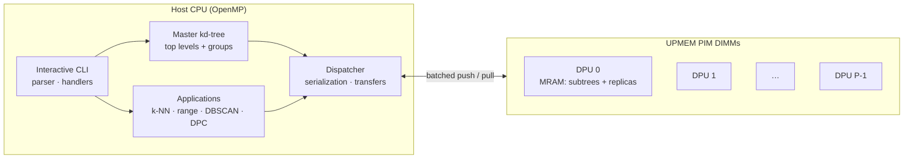

<h1 align="center">PIM-KDTree</h1>

<p align="center">
  <b>A batch-dynamic, distributed <i>k</i>d-tree for real Processing-in-Memory hardware (UPMEM)</b><br>
  Build · Insert · Delete · k-NN · Range search · DBSCAN · Density-Peak Clustering
</p>

<p align="center">
  
  
  
  
</p>

---

## Overview

The *k*d-tree is the standard data structure for multi-dimensional search, but on
conventional CPUs it is limited by the **memory wall**: almost every step of a tree
traversal is a cache miss, so performance is set by DRAM latency and bandwidth rather
than by compute.

**Processing-in-Memory (PIM)** attacks that bottleneck by placing small processors
directly inside the memory modules. This project implements a *k*d-tree that is
**partitioned across many in-memory processors (DPUs)** on UPMEM hardware,
so that queries and updates run next to the data instead of hauling it to the CPU.

The design follows the algorithm in
*Optimal Batch-Dynamic kd-trees for Processing-in-Memory with Applications*
(Zhao, Kang, Gu, Blelloch, Dhulipala, McGuffey, Gibbons), with ideas on batch updates
from *Parallel kd-tree with Batch Updates* (Men, Shen, Gu, Sun — PACMMOD 2025).

### Highlights

- **End-to-end PIM system in C** — ~17k lines split between host code (CPU) and six
  independent DPU kernels.
- **Load-balanced distribution** — the tree is split into *groups* by subtree size;
  upper levels are **replicated** across DPUs while lower levels are **partitioned**,
  so no single DPU becomes a hotspot under skewed queries.
- **Batch-dynamic updates** — inserts and deletes are applied in batches, with
  **approximate counters** deciding when a subtree is unbalanced enough to rebuild
  (controlled by the α/β parameters).
- **Push-pull query execution** — the host chooses per batch whether to push queries
  to the DPUs holding the data or pull small subtrees back to the host, minimising
  CPU↔PIM traffic.
- **Real applications on top** — exact/approximate *k*-NN, orthogonal range queries,
  **DBSCAN** and **Density-Peak Clustering (DPC)**.
- **Interactive CLI** with tree inspection, validation, memory statistics and
  per-DPU views — built for debugging and benchmarking a distributed structure.
- Host-side parallelism with **OpenMP**; runs on real UPMEM DIMMs or the
  **UPMEM functional simulator** (no special hardware needed to try it).

---

## Architecture



| Layer | Responsibility |
|---|---|
| **Host** (`src/host`) | Owns the global view of the tree, decides how it is split into groups, batches operations, serializes subtrees and orchestrates the DPUs. |
| **DPU kernels** (`src/dpu/task`) | Small programs loaded onto every DPU, one per phase: `Build`, `Distribute`, `Search0`, `Push`, `Pull`, `Update`. |
| **Shared core** (`src/dpu/kdTree`) | Tree construction, counters, serialization and update logic compiled for the DPU's constrained environment (64 KB WRAM, no OS). |

### Repository layout

```
.
├── src/
│   ├── host/
│   │   ├── main.c              # entry point
│   │   ├── environment/        # config loading (.env)
│   │   ├── kdTree/             # build, update, distribute, search, serialization, print
│   │   ├── loader/             # DPU allocation and kernel dispatch
│   │   ├── management/         # CLI: commands, parser, handlers, logging, metrics, timer
│   │   └── query/              # knn.c, range.c, dbscan.c, dpc.c
│   └── dpu/
│       ├── task/               # one main*.c per DPU kernel → build/<Name>.dpu
│       ├── kdTree/             # DPU-side tree logic
│       └── environment/
├── include/                    # headers mirroring src/
├── data/                       # generated datasets (git-ignored, see below)
├── scripts/
│   └── generate.sh             # random dataset generator
├── workspace/                  # reference papers
├── .env                        # runtime parameters
└── Makefile
```

---

## Getting started

### Prerequisites

- Linux (x86-64)
- [UPMEM SDK](https://sdk.upmem.com/) (provides `dpu-upmem-dpurte-clang`, `libdpu` and the simulator)
- `gcc` with OpenMP, `make`

### Build

```bash
git clone https://github.com/sclosaf/PIM-KDTree.git
cd PIM-KDTree
make            # builds build/main (host) and build/*.dpu (one per kernel)
```

### Generate the datasets

Datasets are not stored in the repository. Generate the four standard ones
(about 44 MB in total, a few seconds):

```bash
./scripts/generate.sh -a
```

This creates `data/100Dataset.bin`, `data/1000Dataset.bin`, `data/1MlnDataset.bin`
and `data/10MlnDataset.bin`, which the CLI loads as `d100`, `d1000`, `d1mln` and `d10mln`.

### Run

On the UPMEM simulator (no PIM hardware required):

```bash
make run
```

On a machine with real UPMEM DIMMs:

```bash
./build/main
```

`make clean` removes the `build/` directory.

---

## Usage

The program starts an interactive shell (`>>`). Type `help` (or `h`) for the full list
and `help <command>` for its flags.

| Command | Short | Description |
|---|---|---|
| `build` | `b` | Build a tree on the CPU (`-c`) or on PIM (`-p`) from a dataset (`-d`) |
| `insert` | `i` | Insert points from file, random (`-r N`) or explicit coordinates (`-c`) |
| `delete` | `d` | Delete by coordinates, random points, or whole leaves |
| `knn` | `k` | *k*-nearest-neighbour queries; `-a ε` for approximate search |
| `range` | `r` | Orthogonal range queries (`min1 max1 min2 max2 …`) |
| `dbscan` | `db` | DBSCAN clustering (`-e ε -m minPts`) |
| `dpc` | `dp` | Density-Peak Clustering |
| `info` | `inf` | Inspect the tree: tree view, stats, memory, replicas, validation, per-DPU (`-o id`) |
| `config` | `c` | Show or reset system parameters |
| `set` | `s` | Change a parameter at runtime |
| `bench` | `be` | Run benchmarks |
| `quit` | `q` | Exit |

Datasets: `d100`, `d1000`, `d1mln`, `d10mln` (generate them first, see [Generate the datasets](#generate-the-datasets)).

### Example session

```text
>> build -p -d d1mln          # distribute a 1M-point tree across the DPUs
>> info -s                    # tree statistics
>> insert -r 10000            # batch insert 10k random points
>> knn -k 10 -r 1000          # 1000 random 10-NN queries
>> range -r 500               # 500 random range queries
>> dbscan -e 15.0 -m 8        # cluster the data
>> info -v                    # check tree invariants after the updates
>> quit
```

---

## Configuration

Runtime parameters are read from `.env` and can be changed live with `set`.

| Parameter | Default | Meaning |
|---|---|---|
| `nPoint` | 1000 | Number of points (should satisfy *n* > *P*·(log₂ *P*)³) |
| `minCoord` / `maxCoord` | −1000 / 1000 | Coordinate range |
| `nPim` | 64 | Number of DPUs *P* (≥ 2) |
| `dimensions` | 3 | Dimensionality *D* (1–15) |
| `alpha`, `beta` | 2.0, 2.0 | Rebalancing thresholds (0 < α < 8, α/2 < β < 2α) |
| `leafWrapThreshold` | 8 | Max points per leaf φ |
| `oversamplingRate` | 2 | Sampling rate σ used to pick split values |
| `sketchHeight` | 6 | Height λ of the cached top-of-tree sketch |
| `chunkSize` | 64 | Transfer chunk size (2^λ) |
| `stream` / `severity` | `run.log` / `INFO` | Logging target and level (`NONE`…`INFO`) |

### Custom datasets

Datasets are raw little-endian 32-bit floats. The program reads
`nPoint × dimensions` values, so a file must contain at least that many floats.

```bash
./scripts/generate.sh -a                          # all four standard datasets
./scripts/generate.sh -n 3000000 -o 1MlnDataset.bin   # replace one with 1M 3-D points
./scripts/generate.sh -n 500 -m -10 -M 10         # data/dataset.bin + data/dataset.txt preview
```

| Flag | Meaning | Default |
|---|---|---|
| `-n <num>` | Number of floats to generate | – |
| `-m` / `-M` | Value range | −1000 / 1000 |
| `-o <file>` | Output name inside `data/` | `dataset.bin` |
| `-a` | Generate all standard datasets | – |

---

## References

1. Y. Zhao, H. Kang, Y. Gu, G. E. Blelloch, L. Dhulipala, C. McGuffey, P. B. Gibbons.
   *Optimal Batch-Dynamic kd-trees for Processing-in-Memory with Applications.*
2. Z. Men, Z. Shen, Y. Gu, Y. Sun. *Parallel kd-tree with Batch Updates.*
   Proc. ACM Manag. Data 3(1), 2025. [doi:10.1145/3709712](https://doi.org/10.1145/3709712)
3. [UPMEM SDK documentation](https://sdk.upmem.com/)

## Author

**sclosaf** — [github.com/sclosaf](https://github.com/sclosaf)
